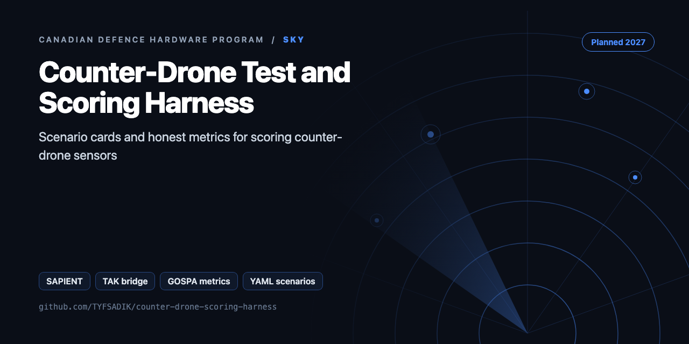
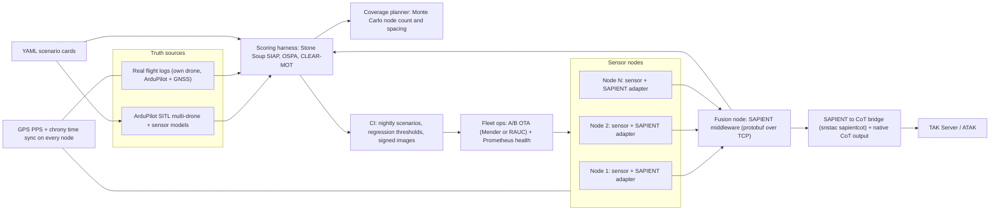

<div align="center">



# Counter-Drone Test-and-Scoring Harness with Sensor-Fleet Operations

**Build guide for a counter-drone test-and-scoring harness: SAPIENT node interface, TAK bridge, YAML scenario cards, Stone Soup metrics, and a coverage planner.**

[](https://github.com/TYFSADIK/counter-drone-scoring-harness/actions/workflows/tests.yml)   [](LICENSE) [](https://github.com/TYFSADIK/defence-hardware-program)

[Build guide](docs/project-page.md) · [How it works](#how-it-works) · [Quick start](#quick-start) · [Program hub](https://github.com/TYFSADIK/defence-hardware-program)

</div>

## Overview

This is a published build guide for a counter-drone test-and-scoring harness: software that connects low-cost sensor nodes to military command-and-control standards (SAPIENT and Cursor on Target), runs repeatable YAML scenario cards against time-synced ground truth, scores performance with Stone Soup metrics, plans sensor coverage, and operates the resulting node fleet with signed updates and health monitoring.

Status: **Planned**. Nothing on this page is built, tested, measured, or flown yet. The guide is written against real Canadian government requirements: the IDEaS counter-drone sandbox guide, which asks for systems that integrate into military C2 and names networks of low-cost sensors as an emphasis area, and the CAF national counter-drone tender, which asked a contractor to design, install, integrate, test, validate, maintain, sustain and modernize the capability as a service (verify dates/scope). This build puts DevOps and test discipline into that gap: the boring, decisive work of knowing what a sensor network actually does and proving it with numbers.

The sandbox itself rewards honesty. Teams are encouraged to push a system to failure so its limits are understood, and plain radar, acoustic, RF or optical detection is less likely to be selected unless it is clearly improved. A scoring harness is exactly the tool for that: it produces the detection probability vs range curves, false-alarm rates and failure envelopes that make a submission credible, and it stays useful for any sensor build, including the [counter-drone sensor fusion](https://github.com/TYFSADIK/counter-drone-sensor-fusion) build on this site.

## How it works



## Quick start

```bash
pip install -r requirements.txt
python demo.py && python -m unittest -v
```

Real output from the demo, run on simulated data:

```text
FAIL  single multirotor inbound, two RF + one radar: {"mean_gospa": 25.37, "rmse_m": 15.34, "pd": 0.717, "false_per_min": 13.0, "time_to_detect_s": {"T1": 32.0}, "undetected": []}
   - false/min 13.0 > 6
PASS  three-drone crossing swarm: {"mean_gospa": 19.7, "rmse_m": 8.18, "pd": 0.915, "false_per_min": 1.33, "time_to_detect_s": {"S1": 0.0, "S2": 0.0, "S3": 0.0}, "undetected": []}
sensor sites: [(0, 0), (0, -250), (0, 500), (0, -750)] coverage: {'k1': 1.0, 'k2': 0.9320477502295684}
```

## What's in this repo

| File | Purpose |
|---|---|
| `harness/messages.py` | SAPIENT-style `DetectionReport`, independent of the wire format (add protobuf bindings later) |
| `harness/scenario.py` | Loads YAML scenario cards: truth waypoints, sensors (Pd, σ, clutter rate, range), pass criteria |
| `harness/simulate.py` | Synthetic sensor reports with misses, noise, and Poisson clutter |
| `harness/scoring.py` | **GOSPA** (split into localisation, missed, and false), Pd, false alarms per minute, time to detect, criteria check |
| `harness/coverage.py` | Greedy k-coverage sensor placement |
| `harness/cot.py` | TAK bridge (CoT XML) |
| `harness/cli.py` | `python -m harness.cli scenarios/*.yaml` exits non-zero on failure, so it can run in CI |
| `scenarios/` | Example cards: single inbound, crossing swarm |
| `.github-ci-example.yml` | Workflow that re-scores every card on each push |

## What you need

- A drone running ArduPilot with GNSS (RTK if possible) as the known-truth target for live scoring runs.
- GPS PPS receivers and antennas, one per node, for chrony time discipline.
- Low-cost sensor nodes (acoustic, optical, or RF receive-only); the exact sensor set is chosen after Phase 0, since the sandbox deprioritizes plain unimproved detection.
- A host machine (existing homelab capacity) for the fusion node, TAK Server, scoring harness, CI runners and Prometheus.
- Spares per the Phase 8 spares log, sized once node count is known.

## Spec gaps

How the hobby build compares with the requirement it is built against:

| Sandbox requirement | Status | Notes |
|----|----|----|
| SAPIENT (BSI Flex 335) interface on nodes | Planned | Phase 0-1; compliance test harness version predates Flex 335 v2, interface version to check |
| C2 integration: Cursor on Target / TAK | Planned | Phase 1 bridge via snstac sapientcot (verify version support) plus native CoT output |
| C2 integration: JREAP-C J-series, VMF K-series | Not planned | No equipment or access; stated honestly as out of scope |
| Micro UAS threat class coverage | Not tested | Scenario cards and SITL truth planned; no live flights yet |
| Mini UAS threat class coverage | Not tested | 25 km radius is beyond any hobby live test; simulation only |
| Drones under 250 g | Not tested | Hard case; scenario cards tagged, scoring planned |
| Fast FPV | Not tested | Speed band in card schema; sim only at first |
| Swarms of 3+ | Simulation only, planned | ArduPilot SITL multi-drone truth in Phase 4 |
| Fibre-optic tethered drones (tethers to 30 km) | Not tested | RF receive-only rules out RF detection of these; stated as a known gap |
| Birds and clutter | Planned | Logged as their own false-alarm class, not silently filtered |
| Rain, fog, snow, night | Not tested | Environment tags on cards; real-weather runs wait for seasons and hardware |
| Early warning beyond 3 km | Not tested | First-detection range distribution will show what is real |
| Fixed base 2.5 km radius: node count and spacing | Planned | Phase 6 Monte Carlo coverage planner |
| 10 km linear border: node count and spacing | Planned | Phase 6, with cost per kilometre |
| Patrol, dismounted, urban, ship scenarios | Card format only | Cards written; live versions not planned at hobby scale |
| Low emissions / DND 552 spectrum form | Met by design | Harness is receive-only; no emitters, no form required |
| Tender lifecycle: install to modernize | Planned | Phase 8 runbooks; unproven until a real multi-node site exists |

## What gets measured

- Stone Soup SIAP metrics: completeness, ambiguity, spuriousness, continuity.
- OSPA (optimal subpattern assignment) for multi-object tracking error.
- CLEAR-MOT for tracking identity quality.
- Detection probability vs range, per scenario card and aggregated.
- First-detection range distribution (the early-warning number).
- Time to first alert.
- False alarms per hour, with birds and aircraft logged as their own class.
- Localization error vs range.
- Clock offset per node as a time-sync health metric.
- Coverage planner outputs: node count, spacing, cost per kilometre.
- Fleet health: battery, temperature, GNSS lock, link quality per node.

## Roadmap

- [ ] Phase 1: generate SAPIENT protobuf bindings (BSI Flex 335 v2.0 .proto files) and build a TCP adapter that emits `DetectionReport`
- [ ] Phase 2: ground truth from real flight logs (ArduPilot `.bin` to waypoints) with a GPS-disciplined time source (chrony + PPS)
- [ ] Phase 4: run SITL swarms to produce truth at scale
- [ ] Cross-check `gospa()` against `stonesoup.metricgenerator.ospametric.GOSPAMetric`
- [ ] Score real sensor nodes: the acoustic detector, passive radar, and multi-domain COP all emit `DetectionReport`

## Related builds

- [Counter-Drone Sensor Fusion](https://github.com/TYFSADIK/counter-drone-sensor-fusion): the sensor-side build this harness is designed to score and stress to failure.
- [Secure Fleet Updates](https://github.com/TYFSADIK/secure-fleet-updates): the signed A/B OTA and measured-boot work reused in Phase 8 fleet operations.
- [Decision Black Box](https://github.com/TYFSADIK/decision-black-box): tamper-evident logging, the same evidence discipline this harness applies to acceptance tests and scoring runs.
- [Thermal Search-and-Rescue Drone](https://github.com/TYFSADIK/thermal-sar-drone): the ArduPilot drone platform whose logged flights double as ground-truth targets here.
- [Defence Hardware Program](https://github.com/TYFSADIK/defence-hardware-program): the parent page for all six Canadian defence build guides.

## Safety and legal

- Defensive only: detect, score, plan. Nothing in this build jams, spoofs, or carries anything.
- RF receive-only unless licensed. Low emissions are preferred by the sandbox; any emitter would need a DND 552 spectrum form, and none is planned.
- Test only my own gear, with permission. Ground-truth drone flights follow the same Transport Canada rules as the other drone builds on this site.
- Birds and aircraft create false alarms. They are logged as their own class, never silently dropped, because hidden filtering is how false-alarm rates get lied about.
- Define detection before flying. The detection definition is part of the scenario card, written before data exists.
- Synthetic data for anything mimicking protected material, per the shared rules for all six builds.

## Learn more

The full build guide, with step-by-step instructions, wiring, troubleshooting and lessons learned, is in [docs/project-page.md](docs/project-page.md). It is also published at [tyfsadik.org](https://tyfsadik.org/work/defence/counter-drone-scoring-harness.html).

## License

[MIT](LICENSE). Built by [Taki Sadik](https://tyfsadik.org) as part of the self-funded [Canadian Defence Hardware Program](https://github.com/TYFSADIK/defence-hardware-program).
